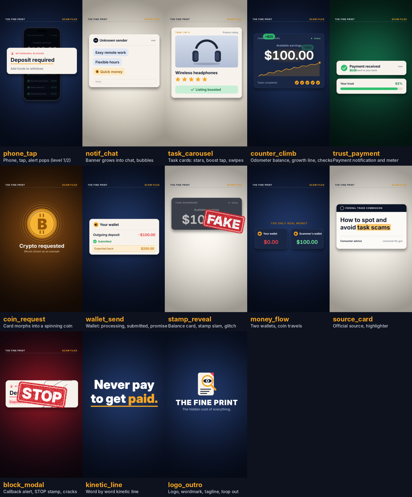

# The Fine Print · motion engine

Code rendered vertical Shorts (1080x1920, 30 fps) for **The Fine Print**. Every frame is drawn with Python + Pillow, encoded with FFmpeg, with synthesized sound design and a music bed, mastered to -14 LUFS.

An episode is **a voiceover, a script and a beat sheet**. The beat sheet places templates from the library on the timeline; the engine handles motion, handoffs between scenes, camera, backgrounds, captions, SFX and music.



## Quick start

```bash
pip install -r requirements.txt          # also needs ffmpeg and the Inter font family
# 1. prepare the voice and captions
python tools/prep.py my_vo.mp3 episodes/e002/script.txt episodes/e002
#    -> vo_tight.flac (pauses trimmed), caps.json, caps_review.txt (check it)
# 2. write episodes/e002/beats.json (see below and episodes/e001/beats.json)
# 3. check stills while you iterate
python -m fpm.render episodes/e002/beats.json info
python -m fpm.render episodes/e002/beats.json sheet /tmp/sheet.png 0 2 4 6 8 10
# 4. build the final video (parallel render, audio, master, QC)
./build.sh episodes/e002
```

## Script format (`script.txt`)

One caption per line, in spoken order.

```
You tap *withdraw*.
The job asks for a *deposit*.
|Then comes the *catch*.
```

* `*word*` marks the keyword shown in orange in the caption.
* `|` at the start keeps a longer dramatic pause before that line (0.45 s instead of 0.20 s).
* Lines starting with `#` are ignored.

Alignment uses the pauses in the speech plus character counts (no speech recognition). On E001 it placed 32 of 34 lines within 0.3 s of the hand timed captions. Always skim `caps_review.txt`; if a line is off, edit `caps.json` directly.

## Beat sheet (`beats.json`)

```json
{
  "show": "THE FINE PRINT", "series": "SCAM FILES",
  "vo": "vo_tight.flac", "captions": "caps.json",
  "music": [[0, "tension"], ["c2-0.3", "bait"], ["c16-0.22", "cut"], ["c16+0.2", "dark"],
            ["c28-0.06", "build"], ["c30", "hit"], ["c31-0.05", "resolve"]],
  "scenes": [
    {"t": "phone_tap", "start": 0, "bg": "navy",
     "p": {"tap": "w0:withdraw-0.1", "block": "c0e-0.45", "level": 1, "exit": "whip_up"}},
    {"t": "notif_chat", "start": "c2-0.3", "bg": "cream", "bg_from": "bottom",
     "p": {"banner": "c2", "bubbles": ["c3", "c4", "c5"], "lines": ["Easy remote work", "Flexible hours", "Quick money"]}}
  ]
}
```

### Time anchors

Anywhere a time is expected:

| anchor | meaning |
|---|---|
| `3.25` | absolute seconds |
| `c9` / `c9e` | start / end of caption 9 (0 based, see `caps_review.txt`) |
| `w18:own money` | estimated moment the phrase is spoken inside caption 18 |
| `end` | end of the episode |
| `c9+0.76`, `w7:boost-0.1` | any anchor plus or minus seconds |

Time the visual beat to the **stressed word** (`w` anchors), not to the start of the sentence.

### Scene keys

| key | meaning |
|---|---|
| `t` | template name (see [docs/TEMPLATES.md](docs/TEMPLATES.md)) |
| `start` | when the scene begins; it ends when the next scene starts |
| `p` | template params |
| `bg` | background: `navy`, `cream`, `green`, `purple`, `amber`, `paper`, `redwarn` (omit to keep the current one) |
| `bg_from` | wipe origin: `bottom`, `top`, `center`, `left`, `right` or `[x, y]` |
| `bg_mode` / `bg_dur` / `bg_delay` | `radial` (default) or `fade`, duration, offset from scene start |
| `enter` / `exit` | card intro and exit style override |
| `morph` | `false` to stop a card scene from morphing out of the previous card |
| `exit_lead` | start the exit animation this many seconds before the scene ends |

### Handoffs

Card templates morph out of the previous card automatically (size, radius, color and content cross fade). `trust_payment` and `money_flow` pin the previous card small at the top, `coin_request` turns the previous card into a coin, and the coin flies into a following `wallet_send`. Anything else exits with its own animation.

### Music moods

`tension`, `bait`, `dark`, `dark_plus`, `build` (ends in a kick roll), `hit` / `cut` / `silence`, `resolve`. A short `cut` before a big line makes it land.

## Audience profiles

Set `"profile"` at the top of `beats.json`. Default is `standard`.

| | `standard` | `calm` (older viewers) |
|---|---|---|
| Camera drift | full | half |
| Punch ins / shakes | full | 40% / 15% |
| Motion blur on whips, glitch on stamps | on | off |
| Flashes | full | 30% |
| Captions | Inter Bold 52 | Inter Bold 66 |
| Music under voice | 0.42, ducked 55% | 0.22, ducked 70% |
| SFX | 0.5, full band | 0.3, low passed at 4.5 kHz, no tick / shimmer / glitch / marker |

The profile only changes how things move and sound. Pacing comes from the beat sheet and the voiceover, so a `calm` episode also needs:

* **Slower voice.** Generate the VO at about 0.9x speed and keep natural pauses: `python tools/prep.py vo.mp3 script.txt EP --keep 0.40 --dramatic 0.70`.
* **Short captions.** About 22 characters per line or less, so the bigger captions don't get scaled back down.
* **Longer holds.** Give each key visual 1.5 to 2.5 s, one idea per screen. The "something new every 0.5 to 0.8 s" rule below does not apply; the camera drift alone keeps the frame alive. QC target for frozen time stays under 2 s.
* **Big details.** Crop in so the detail that matters (a web address, a sticker edge) fills most of the card width instead of sitting at 24 px inside a phone.
* **A clear ending.** Finish with the action steps on screen for 3 to 4 s before the logo, and repeat the main point once.
* **Gentle tone.** Prefer `tension` and `resolve` music moods; avoid stacking `build` + `hit` more than once per episode.

## Design rules (keep these when adding templates)

1. Something new moves every 0.5 to 0.8 s; no hold over 1.2 s. QC target: under 2 s of frozen time.
2. Scenes hand off through shared objects; avoid hard cuts.
3. The camera always drifts; impacts add punch and shake.
4. Pops ease out with overshoot, exits ease in. Never linear.
5. Callbacks escalate (alert level 1 -> 2 -> 3).
6. Every UI event has a sound.
7. Safe layout: brand bug at y 222, content between y 330 and 1340, captions at y 1430, cards 880 px wide.
8. Outro about 3 s, then fade to navy so the video loops.

## Episode specific scenes

One off visuals can live in the episode folder: list them in `beats.json` as `"modules": ["scenes.py"]`. Every `Scene` subclass with a `name` in those files becomes a template for that episode only (sibling files such as `qr_sprites.py` can be imported). Move a scene into `fpm/templates/` once a second episode needs it. See `episodes/e003_calm`.

## Adding a template

1. Add a class in `fpm/templates/` (subclass `CardScene` for single card scenes, `Scene` for anything else).
2. Declare `name`, `TIMES` (time params), `DEFAULTS`, `bg_default`, and implement `draw` (or `card` + `content`) and `events`.
3. Register it in `fpm/templates/__init__.py`, add a demo entry in `tools/library_sheet.py`.
4. Run `python tools/library_sheet.py library.png` and `python tools/gen_docs.py`.

A scene becomes a template when a second episode needs it; one off visuals can live in an episode specific module first.

## Layout

```
fpm/engine.py          easing, Pen (2x supersampled drawing), camera, compositing, backgrounds
fpm/sprites.py         reusable sprites (phone, cards, odometer, coin, stamps, captions, brand)
fpm/templates/         the scene library
fpm/timeline.py        beat sheet parser, anchors, handoffs, event compiler, frame()
fpm/render.py          CLI: info, still, sheet, seg
fpm/audio.py           SFX synthesis, music moods, ducking, mix
tools/prep.py          VO + script -> trimmed VO and timed captions
tools/library_sheet.py template catalog image
tools/gen_docs.py      docs/TEMPLATES.md
build.sh               end to end build with QC
episodes/e001/         Task scams (reference episode)
episodes/e003_calm/    QR code parking scam, calm profile, episode specific scenes
```

## Known limits

* Music is synthesized; a licensed track can replace `build_music` output (the cue sheet stays).
* Captions are timed per phrase; word anchors are estimates by character position.
* Verify any quoted source text (titles, URLs) against the live source before publishing.
