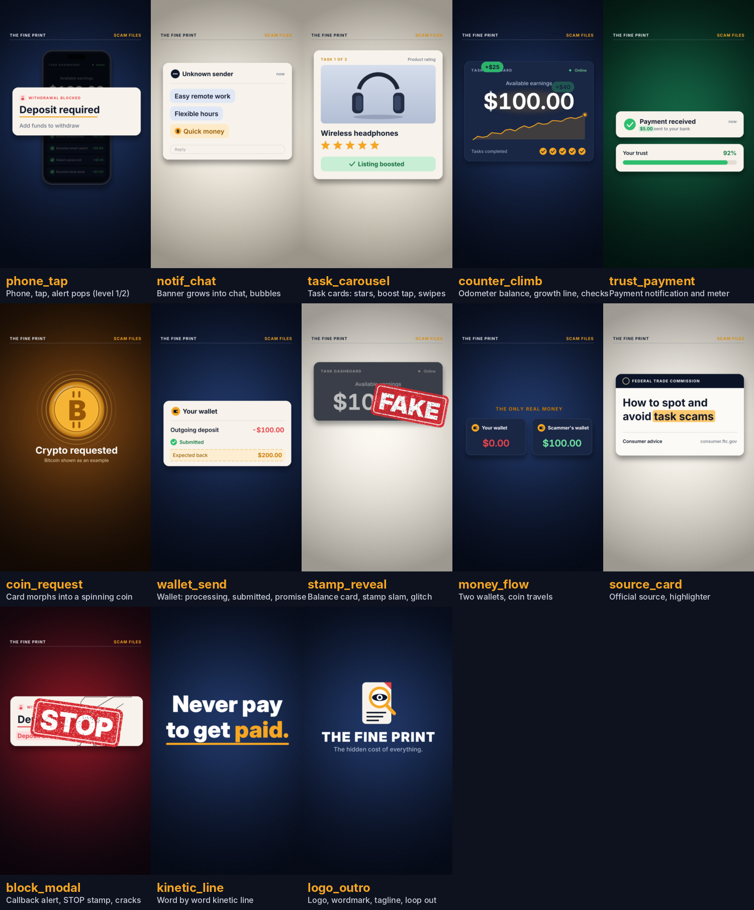

# Template reference

Generated from the code by `tools/gen_docs.py`. Time params accept anchors (see README).

## `phone_tap`

Phone showing a balance; a tap on the main button; optional alert modal that pops over it.
level 1: neutral modal with an underline. level 2: red text swap plus magnifier (escalation).
exit: whip_up (phone and modal fly up with motion blur) | handoff (modal is handed to the next
scene, phone fades) | fade.

* default background: `navy`  ·  consumes previous card: `False`
* time params: `tap`, `block`, `underline`, `red`, `magnifier`
* params and defaults:
  * `balance`: `"$100.00"`
  * `button`: `"Withdraw"`
  * `title`: `"TASK DASHBOARD"`
  * `rows`: `null`
  * `enter`: `"spring"`
  * `exit`: `"whip_up"`
  * `level`: `1`
  * `modal`: `{"tag": "WITHDRAWAL BLOCKED", "title": "Deposit required", "sub": "Add funds to withdraw", "red_sub": "Deposit $100.00 to unlock"}`

## `notif_chat`

Notification banner drops in, then expands into a chat card; message bubbles pop in with typing dots.

* default background: `cream`  ·  consumes previous card: `False`
* time params: `banner`, `expand`, `bubbles`
* params and defaults:
  * `sender`: `"Unknown sender"`
  * `lines`: `["Easy remote work", "Flexible hours", "Quick money"]`
  * `accent`: `-1`

## `task_carousel`

Task cards: stars fill, a boost button gets tapped, then the next tasks swipe in with taps and money chips.

* default background: `cream`  ·  consumes previous card: `True`
* time params: `stars`, `button`, `boost`, `swipes`
* params and defaults:
  * `products`: `[["headphones", "Wireless headphones"], ["watch", "Smart watch"], ["camera", "Camera kit"]]`
  * `chips`: `["+$4.20", "+$6.80", "+$5.10"]`
  * `header`: `"Product rating"`
  * `btn`: `"Boost listing"`
  * `done`: `"Listing boosted"`

## `counter_climb`

Dark dashboard with an odometer balance that rolls through keyframes, a growth line and task checks.
keys: [[time, value], ...]. 'more' spawns floating chips (greed beat).

* default background: `navy`  ·  consumes previous card: `True`
* time params: `checks`, `more`
* params and defaults:
  * `keys`: `[]`
  * `checks`: `null`
  * `chips`: `["+$25", "+$40", "+$60", "+$18"]`
  * `title`: `"TASK DASHBOARD"`
  * `label`: `"Available earnings"`
  * `chk_label`: `"Tasks completed"`
  * `total_checks`: `5`
  * `vmax`: `null`

## `trust_payment`

Pins the previous card small at the top, then a payment notification and a filling meter (trust, credit...).

* default background: `green`  ·  consumes previous card: `True`
* time params: `notif`, `small`, `meter_in`, `meter`
* params and defaults:
  * `title`: `"Payment received"`
  * `amount`: `"$5.00"`
  * `rest`: `"sent to your bank"`
  * `meter_label`: `"Your trust"`
  * `meter_from`: `0.12`
  * `meter_to`: `0.92`

## `coin_request`

The previous card morphs into a spinning coin (lands face on) with a label. If the next scene is a
wallet_send, the coin flies into its wallet icon.

* default background: `amber`  ·  consumes previous card: `True`
* params and defaults:
  * `label`: `"Crypto requested"`
  * `sub`: `"Bitcoin shown as an example"`
  * `glyph`: `"B"`

## `wallet_send`

Wallet card: outgoing deposit, processing spinner then submitted, then a dashed 'expected back' promise.
If the previous scene is a coin, the coin flies into this card's wallet icon at start+0.32.

* default background: `None`  ·  consumes previous card: `False`
* time params: `done`, `expect`
* params and defaults:
  * `title`: `"Your wallet"`
  * `row`: `"Outgoing deposit"`
  * `amount`: `"-$100.00"`
  * `expect_label`: `"Expected back"`
  * `expect_amount`: `"$200.00"`
  * `proc`: `"Processing"`
  * `done_label`: `"Submitted"`

## `stamp_reveal`

Compact dark balance card drops in; a solid stamp slams on it (glitch, shake, white flash), card goes gray.

* default background: `paper`  ·  consumes previous card: `False`
* time params: `stamp`
* params and defaults:
  * `value`: `100.0`
  * `word`: `"FAKE"`
  * `title`: `"TASK DASHBOARD"`
  * `label`: `"Available earnings"`

## `money_flow`

Pins the previous card at the top, a label, two mini wallets, and a coin that travels left to right.

* default background: `None`  ·  consumes previous card: `True`
* time params: `send`
* params and defaults:
  * `label`: `"THE ONLY REAL MONEY"`
  * `left`: `["Your wallet", "$100.00", "$0.00"]`
  * `right`: `["Scammer's wallet", "$0.00", "$100.00"]`

## `source_card`

Official source card (org bar, two line headline with a highlighter sweep on one phrase, footer).

* default background: `paper`  ·  consumes previous card: `False`
* time params: `highlight`
* params and defaults:
  * `org`: `"FEDERAL TRADE COMMISSION"`
  * `lines`: `["How to spot and", "avoid task scams"]`
  * `phrase`: `"task scams"`
  * `footer_l`: `"Consumer advice"`
  * `footer_r`: `"consumer.ftc.gov"`

## `block_modal`

Standalone alert modal (use for callbacks). level 1 neutral, 2 red text, 3 red text plus STOP stamp and cracks.
creep: slow camera push from that time until the stamp. Exit zoom_through flies the camera through the card.

* default background: `redwarn`  ·  consumes previous card: `False`
* time params: `magnifier`, `stop`, `creep`
* params and defaults:
  * `level`: `3`
  * `word`: `"STOP"`
  * `exit`: `"zoom_through"`
  * `modal`: `null`
  * `hide_stop_caption`: `true`

## `kinetic_line`

Big kinetic line, word by word slams (Inter Display Black). lines: [["Never","pay"],["to","get","paid."]].
accent: words drawn in orange. times: optional explicit word times, else spread over the first 55% of the scene.

* default background: `navy`  ·  consumes previous card: `False`
* time params: `times`, `underline`
* params and defaults:
  * `lines`: `[["Never", "pay"], ["to", "get", "paid."]]`
  * `accent`: `["paid."]`
  * `size`: `156`
  * `underline`: `null`
  * `spread`: `0.55`

## `logo_outro`

Logo icon pop with ring, staggered wordmark, tagline, then a zoom and fade to navy for a clean loop.

* default background: `navy`  ·  consumes previous card: `False`
* time params: `tag`
* params and defaults:
  * `title`: `"THE FINE PRINT"`
  * `tagline`: `"The hidden cost of everything."`
  * `zoom`: `0.38`
